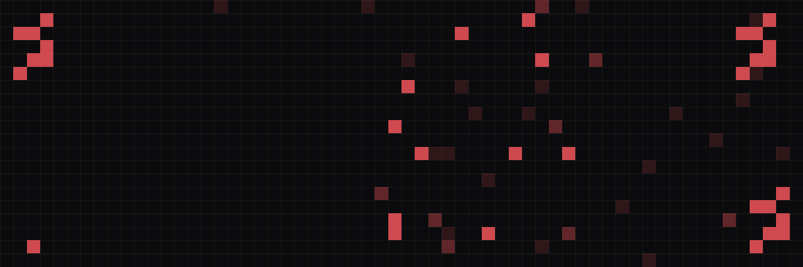

  

## Hexoddity Labs

**Built for us. Proven for you.** We build infrastructure, SaaS products and full-stack systems for fast-growing B2B teams. Every product we sell started as a tool we needed ourselves.

### Products

| Product | What it does |
|---|---|
| **[AnchorHub](https://hexodditylabs.dev/anchorhub)** | A CRM that tracks every lead back to the ad that brought it in, and reports the sale back to the ad platform. |
| **[loftOKR](https://hexodditylabs.dev/loftOKR)** | OKR management for fast-moving teams: tasks, goals and time in one place. |
| **[HexNet](https://hexodditylabs.dev/hexnet)** | Network monitoring with instant alerts, for teams that can't afford downtime. |
| **[Onilytics](https://hexodditylabs.dev/onilytics)** | Analytics and project tracking for web3 teams. |
| **[0x0D Studios](https://hexodditylabs.dev/hexstudio)** | Our in-house game studio, and the tools that power its games. |

### Services

[Development](https://hexodditylabs.dev/development) · [Infrastructure](https://hexodditylabs.dev/infrastructure) · [AI](https://hexodditylabs.dev/ai) · [Web3](https://hexodditylabs.dev/web3) · [Marketing](https://hexodditylabs.dev/marketing) · [Strategy](https://hexodditylabs.dev/strategy)

### Work with us

Our code is private. To talk about a project or one of our products, email **hello@hexodditylabs.dev** or go to [hexodditylabs.dev/contact](https://hexodditylabs.dev/contact).
